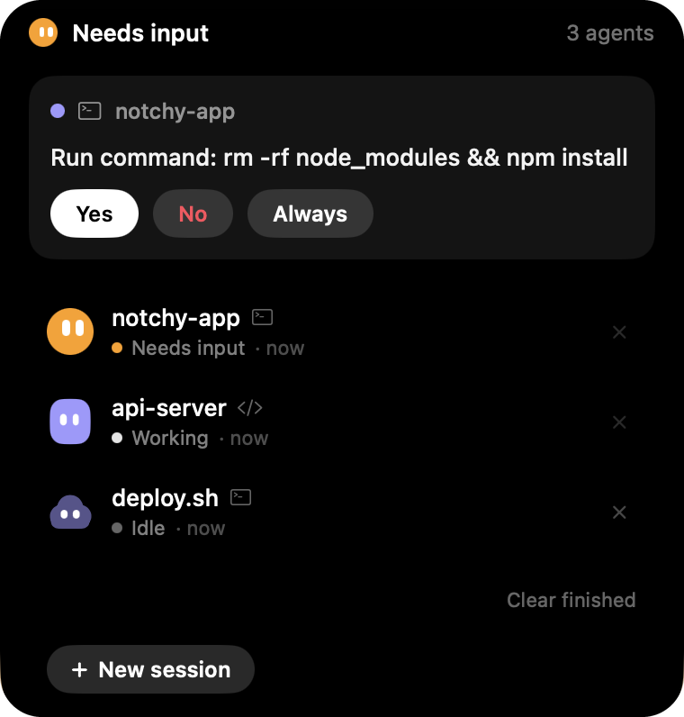
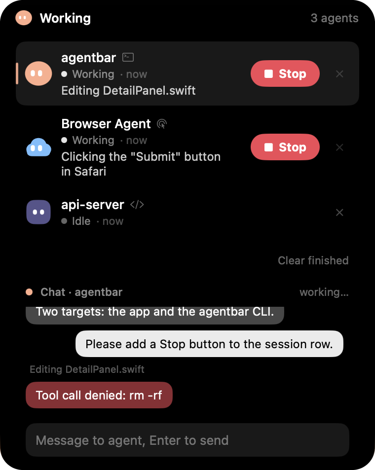
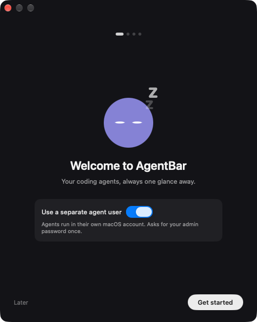
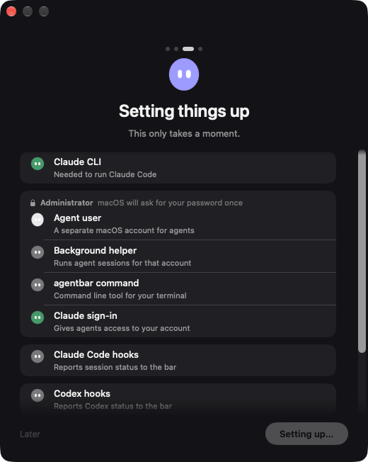
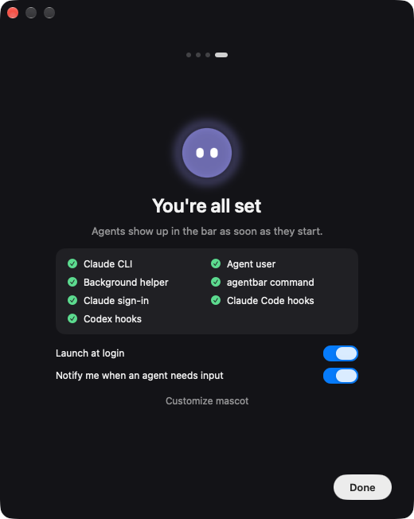
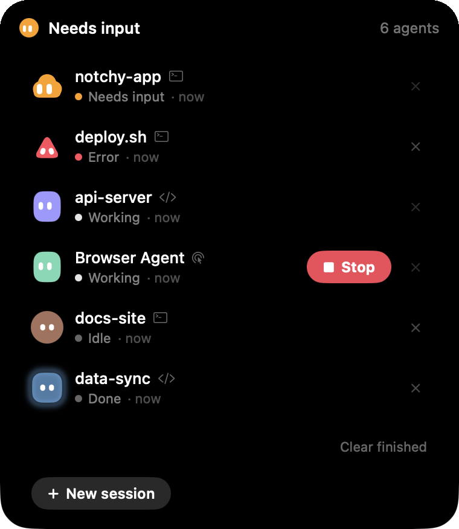
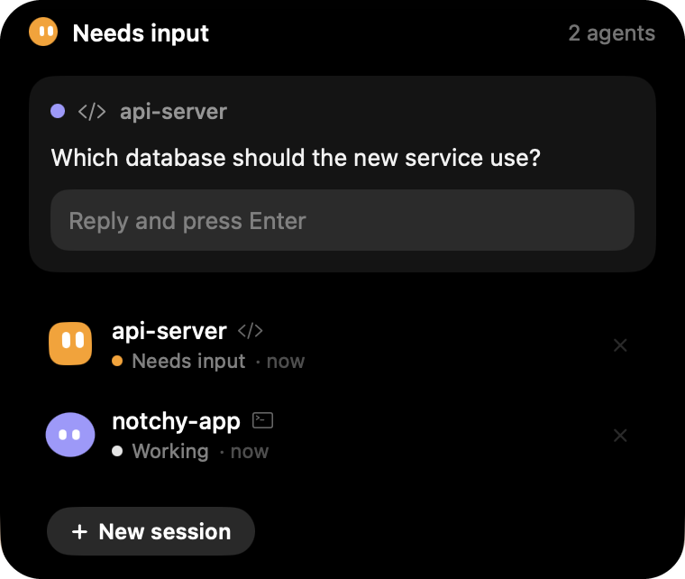
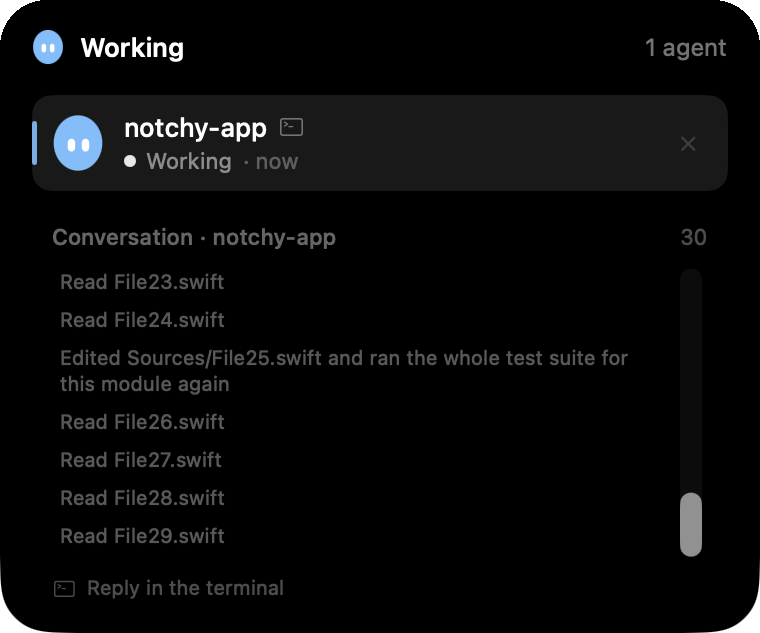

# AgentBar

A tiny, always-on status and input bar for AI agents on macOS. Works with Claude Code today; Codex, generic CLI agents and
computer-use agents are planned (see [ROADMAP.md](ROADMAP.md)).

- **Idle:** a small friendly blob at the notch (or a floating pill / draggable circle on Macs without a notch).
- **Working:** the blob breathes. **Needs you:** it turns amber and looks at you.
- **Hover:** the bar softly expands into a panel with open requests from all agents (Allow / Deny / Always), a reply field,
  a short history, and a remove button per agent.
- **Local only:** Unix-domain socket with a random token, no network listener.

<p align="center">
  
  
</p>

Status: early MVP (Phase 1). Real Claude Code permission flows are not yet verified end to end, see the roadmap.

## First run: onboarding
On the first start AgentBar opens a setup window (4 pages: Welcome, Login, Setting things up, You're all set). It can be
reopened any time from the menu bar icon via "Setup…".

<table>
  <tr>
    <td align="center"><br><sub>Welcome</sub></td>
    <td align="center"><br><sub>Setting things up</sub></td>
    <td align="center"><br><sub>You're all set</sub></td>
  </tr>
</table>

- **Claude login in the browser:** the app runs `claude setup-token` for you; you approve in the browser (or paste a token).
  The token is never shown in the window.
- **One admin password prompt** (a single macOS dialog) creates the separate agent user, the background helper and the
  `agentbar` command. No Terminal and no `sudo` needed.
- **Local only, no admin:** switch off "Use a separate agent user" on the welcome page. Agents then run as you, no password
  prompt, only the hooks are set up.
- **Existing `agentbar` account:** it is adopted and hardened best effort, its UID is not changed. A newly created account is a
  hidden role account with UID 200..399 and shell `/usr/bin/false`.
- The old manual route (`sudo Scripts/setup-agent-user.sh`) still works by hand, see `--dry-run`.

Not yet verified on a real system: the admin run from the app (password dialog, whether Touch ID is offered), the real
`claude setup-token` flow, creating or adopting the account in the app context, and Codex hooks. Treat the onboarding as
untested until the roadmap says otherwise.

## Session chat
Every session shows up as a chat with speech bubbles in the panel. Sessions started by hooks (a `claude` running in your
terminal) are read-only and show "Reply in the terminal". "Continue in panel" (fork the session into the panel) is planned,
not available yet.

## Screenshots

<table>
  <tr>
    <td align="center"><br><sub>All agents at a glance</sub></td>
    <td align="center"><br><sub>Questions from agents</sub></td>
    <td align="center"><br><sub>Per-session history</sub></td>
  </tr>
</table>

## Build
Requires macOS 14+, Xcode, [XcodeGen](https://github.com/yonaskolb/XcodeGen).
```bash
cd Packages/AgentBarCore && swift build && swift test && bash Tests/e2e.sh
cd ../../App && xcodegen generate && xcodebuild -project AgentBar.xcodeproj -scheme AgentBar build
```
Try it without any agent: run the app with `--demo`. With the app running, use the bundled CLI
(`AgentBar.app/Contents/Resources/agentbar`), e.g.
`agentbar ask --session t --type approval --text "ok?" --option allow:Yes --option deny:No --timeout 60 --default deny`.

## Claude Code hooks
The onboarding sets up the hooks for you. They can also be managed later: menu bar icon → "Set Up Hooks…" shows a diff preview of the changes to `~/.claude/settings.json`, writes a backup, and only
applies after your confirmation. Timeouts and errors never auto-allow: Claude Code falls back to its own dialog.

> **Note:** The hooks store the absolute path to the bundled CLI (`AgentBar.app/Contents/Resources/agentbar`). If the app is moved or renamed (e.g. from the build folder to `~/Desktop` or `/Applications`), run "Set Up Hooks…" from the menu bar icon again.

## Docs
[CONTRACTS.md](CONTRACTS.md) (architecture, wire protocol), [Docs/research](Docs/research), [ROADMAP.md](ROADMAP.md).

## License
MIT
