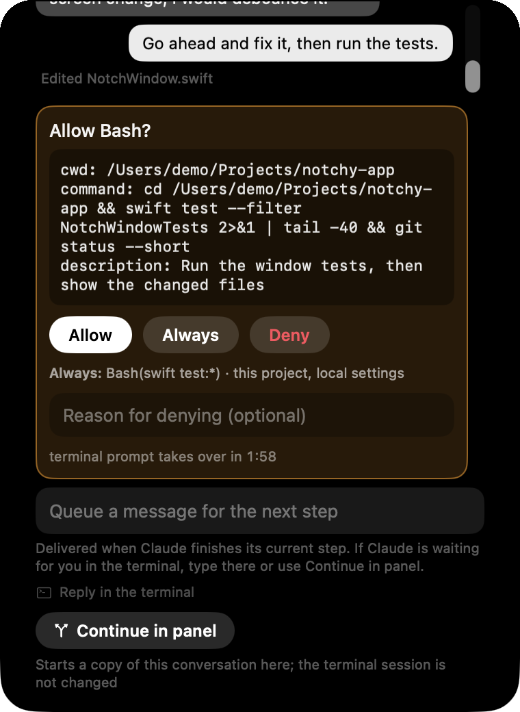
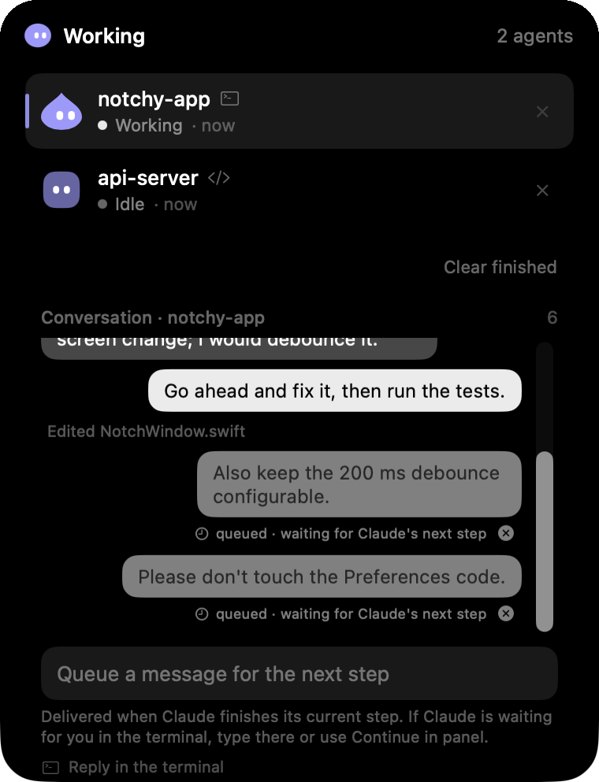

# AgentBar

A tiny, always-on status and input bar for AI agents on macOS. Works with Claude Code today; a Codex adapter exists but is untested, generic CLI agents and
computer-use agents are partly in place (see [ROADMAP.md](ROADMAP.md)).

- **Idle:** a small friendly blob at the notch (or a floating pill / draggable circle on Macs without a notch).
- **Working:** the blob breathes. **Needs you:** it turns amber and looks at you.
- **Hover:** the bar softly expands into a panel with open requests from all agents (Allow / Deny / Always), a reply field,
  a short history, and a remove button per agent.
- **Local only:** Unix-domain socket with a random token, no network listener.

<p align="center">
  
  
</p>

## Status
Phases 1 to 3 and the separate agent user are implemented and run: the notch/pill/circle bar, hover panel, Claude Code
hooks, the Codex adapter code, chat sessions started from the panel (also as the agent user), onboarding, a chat view for
every session, the approval bubble in the conversation (Allow / Always / Deny with an optional reason), "Continue in panel"
(fork), a message queue for terminal sessions and a token expiry notice. The user has run the onboarding, the daemon and
the basic flows by hand.

**Never tried against a real `claude` or Codex (UNVERIFIED):**
- "Continue in panel": the fork via `claude --resume <id> --fork-session`.
- Queue delivery: queued messages are handed over through the Stop hook (a "block" decision with the text as reason); whether
  Claude treats that reason as an instruction is not confirmed.
- The Touch ID option in the admin password dialog of the onboarding.
- Codex: adapter and hooks exist, but no real `codex` has ever run against them.

The demo mode (`--demo`) and the automated tests (`swift test`, `Tests/e2e.sh`) cover the rest, see [ROADMAP.md](ROADMAP.md).

## First run: onboarding
On the first start AgentBar opens a setup window (4 pages: Welcome, Login, Setting things up, You're all set). It can be
reopened any time from the menu bar icon via "Setup…".

<table>
  <tr>
    <td align="center"><br><sub>Welcome</sub></td>
    <td align="center"><br><sub>Setting things up</sub></td>
    <td align="center"><br><sub>You're all set</sub></td>
  </tr>
</table>

- **Claude login in the browser:** the app runs `claude setup-token` for you; you approve in the browser (or paste a token).
  The token is never shown in the window.
- **One admin password prompt** (a single macOS dialog) creates the separate agent user, the background helper and the
  `agentbar` command. No Terminal and no `sudo` needed.
- **Local only, no admin:** switch off "Use a separate agent user" on the welcome page. Agents then run as you, no password
  prompt, only the hooks are set up.
- **Existing `agentbar` account:** it is adopted and hardened best effort, its UID is not changed. A newly created account is a
  hidden role account with UID 200..399 and shell `/usr/bin/false`.
- The old manual route (`sudo Scripts/setup-agent-user.sh`) still works by hand, see `--dry-run`.

The onboarding has been run by the user on a real Mac (agent user adopted, daemon running, token handed over). Not yet
verified: whether the admin password dialog offers Touch ID, the creation of a brand-new role account from the app,
and Codex hooks.

## Session chat
Every session shows up as a chat with speech bubbles in the panel, including sessions started by hooks (a `claude` running in
your terminal).

<p align="center">
  
  
</p>

- **Approval bubble:** a pending permission request appears inside the conversation with the tool, the command, and
  **Allow / Always / Deny**. "Always" shows the exact rule and scope that will be saved (for example `Bash(swift test:*)`,
  this project, local settings). "Deny" takes an optional reason that is passed back to Claude. A countdown shows when the
  terminal prompt takes over; timeouts and errors never auto-allow.
- **Queue a message (terminal sessions):** a terminal session cannot receive text while it runs, so a message typed in the
  panel is shown as *queued* and delivered at Claude's next stop (Stop hook). Up to 3 messages per session (1000 characters each), each can be
  cancelled until it is delivered; a message that waited more than 30 minutes is dropped with a note instead. Once delivered, it appears as a normal bubble.
- **Continue in panel:** forks the session into a new chat in the panel (`claude --resume <id> --fork-session`); the terminal
  session stays unchanged.
- **Safety limits:** "Continue in panel" is only offered for sessions of the owner (not for agent-user sessions), and a
  message only goes to a session with the role it belongs to: the owner role for owner sessions, the agent user for agent sessions.
- **Token expiry:** the Claude token created by the onboarding lasts about a year. From day 330 on, Settings → Setup shows a
  notice (only with the agent user set up); an expired token counts as missing, and it can be renewed from the same tab.

Not verified with a real `claude`: the fork, the queue delivery and the reason-as-instruction behavior (see Status).

## Screenshots

<table>
  <tr>
    <td align="center"><br><sub>All agents at a glance</sub></td>
    <td align="center"><br><sub>Questions from agents</sub></td>
    <td align="center"><br><sub>Per-session conversation</sub></td>
  </tr>
</table>

## Build
Requires macOS 14+, Xcode, [XcodeGen](https://github.com/yonaskolb/XcodeGen).
```bash
cd Packages/AgentBarCore && swift build && swift test && bash Tests/e2e.sh
cd ../../App && xcodegen generate && xcodebuild -project AgentBar.xcodeproj -scheme AgentBar build
```
Try it without any agent: run the app with `--demo`. With the app running, use the bundled CLI
(`AgentBar.app/Contents/Resources/agentbar`), e.g.
`agentbar ask --session t --type approval --text "ok?" --option allow:Yes --option deny:No --timeout 60 --default deny`.

## Claude Code hooks
The onboarding sets up the hooks for you. They can also be managed later: menu bar icon → "Set Up Hooks…" shows a diff preview of the changes to `~/.claude/settings.json`, writes a backup, and only
applies after your confirmation. Timeouts and errors never auto-allow: Claude Code falls back to its own dialog.

> **Note:** The hooks store the absolute path to the bundled CLI (`AgentBar.app/Contents/Resources/agentbar`). If the app is moved or renamed (e.g. from the build folder to `~/Desktop` or `/Applications`), run "Set Up Hooks…" from the menu bar icon again.

## Docs
[CONTRACTS.md](CONTRACTS.md) (architecture, wire protocol), [Docs/research](Docs/research), [ROADMAP.md](ROADMAP.md).

## License
MIT
